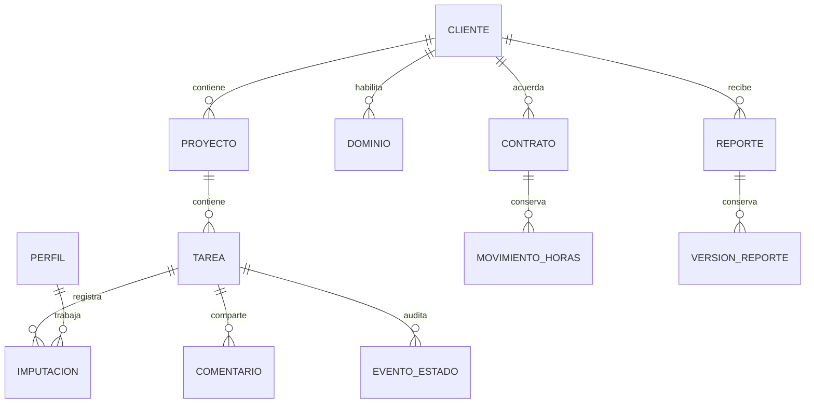

# Modelo de datos propuesto para Teté

Estado: diseño conceptual para revisión. Este documento no contiene SQL ejecutable. La entrega de identidad incluye una migración separada de cuentas y asignaciones de acceso en `supabase/migrations/`; no implementa el resto de este modelo. Fuente funcional y alcance: [índice](README.md). Los nombres y descomposiciones son propuestas técnicas salvo cuando se señala una regla confirmada. Los puntos abiertos se referencian mediante D-xx en [decisiones](decisiones-pendientes.md).

## Relaciones principales

Las relaciones proyecto–contrato y la composición de roles requieren definir D-09 y D-11. D-10 confirma acceso del Colaborador por proyecto y del Administrador de Contrato por empresa. El diagrama no representa todavía un esquema físico completo.

## Entidades operativas

| Grupo | Entidades propuestas | Campos y restricciones principales | Fuente |
| --- | --- | --- | --- |
| Clientes | `clients`, `client_domains` | UUID; cliente interno/externo, activo; dominio normalizado único entre dominios activos y asociado a un cliente | §2–3 |
| Contactos | `client_contacts` | Propuesta para contactos mencionados en ficha; campos y permisos pendientes | §8; D-12 |
| Identidad | `profiles`, `role_assignments`, `client_managers`, `project_members`, `task_participants` | Perfil vinculado inequívocamente al usuario Auth; usuario activo; alcance explícito por asignación. Unicidad de vínculos y consistencia de alcance; composición pendiente | §3–4; D-01, D-10, D-11 |
| Proyectos | `projects`, `project_budget_history` | Cliente obligatorio; responsable; estado; presupuesto habilitado, inicial y vigente; `requires_time_approval`; historial con motivo | §3, §7, §12.1 |
| Tareas | `tasks` | UUID; `ticket_number` global UNIQUE NOT NULL, servidor e inmutable; proyecto obligatorio; responsable y estimación opcionales; prioridad, origen, estado y vencimiento opcional | §3, §15, §18 |
| Referencias históricas | Campos de origen en `tasks` o tabla `task_external_references` | Conservar código heredado, número histórico y GID/URL de Asana sin confundirlos con el número público nuevo | §10, §15 |
| Dependencias | `task_dependencies` | Origen/destino distintos, sin ciclos; vínculo informativo sin bloqueo automático; autorización sobre ambas tareas | §18 |
| Colaboración | `task_comments`, `task_comment_revisions`, `task_attachments` | Cuerpo enriquecido saneado, autor, fechas, respuesta opcional; historial de ediciones. Adjunto vinculado a tarea y opcionalmente comentario de esa misma tarea | §14, §18 |
| Historial de estado | `task_status_events` | Estado anterior/nuevo, autor, instante y motivo; registrar también estado inicial. Unificar aquí la función de `task_status_history` | §3, RF-RM-05; propuesta sujeta a revisión |
| Horas | `time_entries`, `time_entry_revisions` | Tarea, colaborador, fecha efectiva, segundos reales, facturable NOT NULL, minutos computables según política pendiente, validación individual, origen y auditoría de cambios | §6, §12, §16 |
| Temporizadores | `timer_sessions`, `timer_segments`, `timer_entry_links` | Propuesta de segmentos para pausas y cambio de día; como máximo una sesión activa por usuario, instantes de servidor, consolidación única trazable hacia imputaciones | §6, §16; D-04, D-05 |
| Revisión semanal | `timesheet_submissions`, `timesheet_reviews` | Presentación semanal opcional; la aprobación pertenece a cada imputación y a su proyecto, no a una semana global indivisible | §6.1, §12.12 |
| Solicitudes | `incoming_requests`, `request_email_verifications` | Cliente por dominio habilitado, correo y estado de verificación, revisión y vínculo a tarea del mismo cliente; rechazo motivado; verificación y protección contra spam | §5.2, §9.1; mecanismo por definir |
| Auditoría | `audit_events` | Actor, acción, recurso, instante, cambios y motivo cuando corresponda; sin credenciales ni exposición de datos económicos en registros operativos | §9, §12 |

La existencia de varias tablas de membresía no define todavía cómo combinar permisos. No crear asignaciones de alcance ambiguo ni permitir que una relación de participación otorgue poderes administrativos.

TOCH confirmó el 2 de noviembre de 2026 que una persona puede tener varios roles, por ejemplo Administrador de Contrato cliente y Solicitante externo. El modelo debe admitir múltiples asignaciones y conservar una identidad de persona sin duplicarla por cada rol. TOCH confirmó acceso al flujo de solicitudes para cualquier correo verificado de un dominio autorizado, sin preautorización individual. El servidor determina el cliente por el dominio habilitado; no confundir identidad verificada con un correo declarado. Este flujo aún no está implementado y no concede acceso de gestión. La composición general de otros roles sigue pendiente en D-11.

El Administrador de Contrato cliente debe estar vinculado a exactamente una empresa cliente, confirmado por TOCH el 2 de noviembre de 2026. El esquema y las validaciones de servidor deberán impedir asignaciones de ese perfil para varios clientes a una misma persona. No permitir un alcance global ni sin cliente para ese rol. La restricción no limita a un solo cliente al Gerente de Cuenta TOCH; tampoco determina cuántos administradores puede tener una empresa.

Según D-10, confirmada por TOCH el 2 de noviembre de 2026, `project_members` determina el acceso del Colaborador a todas las tareas del proyecto. `task_participants` representa participación operativa, no una concesión independiente de acceso; sus integrantes deben contar con autorización por proyecto. No implementar permisos individuales por tarea. El Administrador de Contrato cliente consulta todas las solicitudes, proyectos, tickets y horas de su empresa, sin datos monetarios.

## Contratos, presupuesto y economía

La combinación Gerente de Cuenta TOCH + Colaborador TOCH fue confirmada por TOCH en el chat el 2 de noviembre de 2026. Una misma identidad puede gestionar clientes asignados y registrar sus propias imputaciones en proyectos autorizados. TOCH confirmó además que el Gerente puede aprobar sus propias horas en proyectos de sus clientes asignados, incluso cuando requieren aprobación. No exigir que aprobador y colaborador sean personas distintas; comprobar el alcance del aprobador y conservar su identidad, fecha e historial de aprobación. Este permiso permite una acción de aprobación propia y no convierte automáticamente en validadas las cargas de proyectos que requieren revisión.

| Entidades propuestas | Responsabilidad e invariantes |
| --- | --- |
| `service_contracts`, `contract_periods`, `hour_movements` | Cuotas por período y bolsas acumulativas; acreditaciones, consumos, ampliaciones, ajustes y vencimientos según configuración aprobada. Saldo derivado de movimientos validados, no editable directamente (§12.5). |
| Vínculo proyecto–contrato | Por definir en D-09. Cada consumo necesita una asignación contractual inequívoca antes de registrarse. |
| `hour_movements` | Origen en imputación/revisión, tipo, magnitud, contrato/período, referencia compensada y clave de idempotencia. Solo horas facturables validadas generan consumo definitivo; sin consumo al emitir reportes (§12.9, §12.12). |
| Cómputo presupuestario | Vista o proyección derivada por proyecto a partir de imputaciones validadas y política aplicable. La contabilización del presupuesto y el ledger contractual describen el mismo trabajo, sin dos cargos contractuales. Tratamiento interno pendiente D-02. |
| `economic.hourly_costs`, `economic.economic_contracts`, `economic.time_entry_valuations` | Propuesta de esquema privado para tarifas vigentes e instantáneas de valoración histórica; permisos exclusivos del Administrador TOCH. Tarifas actuales no recalculan costos ya cerrados (§7.3, §9). |

Usar tipos exactos para moneda y no números de coma flotante. Esto es una propuesta técnica; moneda, precisión, reglas de valoración y cierre económico necesitan definición antes del módulo económico. Ningún campo monetario formará parte de la ficha operativa ni de su PDF.

## Reportes y reconstrucción histórica

| Entidad propuesta | Datos a conservar |
| --- | --- |
| `monthly_reports` | Cliente, período, corte, autor, estado. |
| `monthly_report_versions` | Número de versión, proyectos/estados seleccionados, criterio período/acumulado, categorías y validación de horas incluidas, zona horaria, fecha, autor, hash, referencia a versión rectificada. |
| `monthly_report_items` | Ticket y sus valores al corte: número, título, cliente/proyecto, estado, fecha de cierre aplicable y totales separados por clasificación y validación. |
| `monthly_report_time_entries` | Referencia a imputación y revisión origen, fecha efectiva, segundos y minutos incluidos, clasificación y validación congeladas. Una referencia al registro mutable actual no basta. |
| `monthly_report_artifacts` | Propuesta para PDF/Excel privados vinculados a versión; ruta y metadatos. Descarga autorizada mediante enlace temporal. |

No implementar `monthly_report_deliveries` como entrega automática: el envío es manual y descargar no prueba entrega (§12.10, §12.12). No registrar destinatario o recepción supuestos.

Unificar los eventos de estado evita reconstrucciones diferentes. Las versiones de imputación permiten reproducir correcciones, pero hay que definir si un corte retrospectivo considera lo conocido entonces o las correcciones vigentes al emitir: D-14. También requiere decisión el historial de movimientos de tareas entre proyectos/clientes: D-15.

## Operaciones que deben ser atómicas

1. Crear tarea y asignar número mediante secuencia de base de datos, nunca `MAX + 1`. UUID y número cumplen funciones diferentes (§15).
2. Iniciar/reanudar temporizador comprobando autorización, estado de tarea y exclusión de otra sesión activa del usuario. Resolver carreras entre dispositivos (§6).
3. Cerrar/cancelar tarea y bloquear nuevas horas, coordinando las sesiones activas y evitando carreras con cargas manuales. La especificación exige detención al cierre; extensión a cancelación y confirmación de clasificación pendientes D-04.
4. Consolidar sesiones finalizadas una sola vez, repartiendo días según zona horaria y conservando segundos reales (§6, §16).
5. Validar/corregir/anular imputación y actualizar consumo mediante ajustes compensatorios con claves únicas por origen y revisión (§12.12).
6. Emitir snapshot consistente de reporte sin generar movimientos de consumo y sin alterar versiones previas (§8 bis).
7. Convertir/vincular solicitud de forma idempotente a una tarea del mismo cliente; las diferencias entre crear y vincular deben quedar auditadas (§5.2, §15).

## Restricciones que deberá verificar el esquema físico

- Restringir alta de clientes, configuración de dominios y administración de usuarios y roles al Administrador TOCH, según confirmación del 2 de noviembre de 2026. Aplicar controles en servidor y base de datos; no conceder esos permisos al Gerente ni al Administrador de Contrato cliente.

- Claves foráneas para toda la jerarquía y consistencia de referencias entre tarea, comentario, adjunto, solicitud y proyecto.
- Estados de tarea confirmados: Pendiente, En proceso, En espera, Resuelta, Cerrada, Cancelada. Los códigos técnicos serán estables; edición de catálogo pendiente D-12.
- Segundos reales separados del tiempo computable; política de redondeo pendiente D-05.
- Secuencia y restricciones únicas resistentes a concurrencia, reintentos y doble consolidación.
- Prohibición de nuevas imputaciones en tareas cerradas/canceladas verificada en servidor/base de datos, incluso con fecha retroactiva.
- Totales y saldos derivados; historial preservado ante desactivación, cierre y anulación. Reglas de borrado y retención pendientes D-16.
- RLS y permisos de Storage por alcance; revocación de acceso para usuario desactivado. Revisión humana antes de habilitar clientes.

Este diseño no es todavía un esquema aprobado. La implementación de restricciones y políticas se definirá con migraciones versionadas y pruebas de los criterios de aceptación de la especificación.
